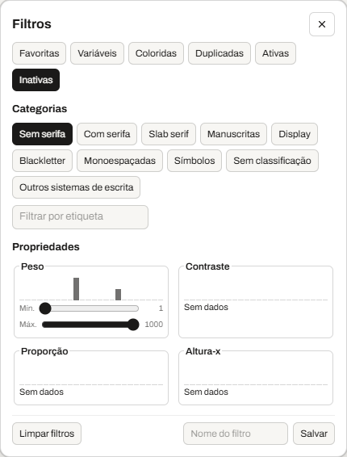
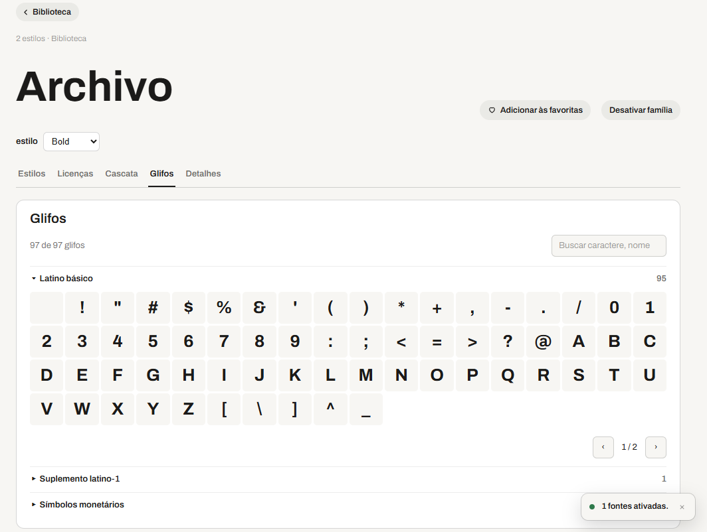
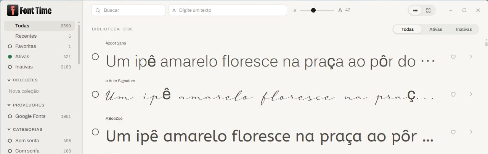
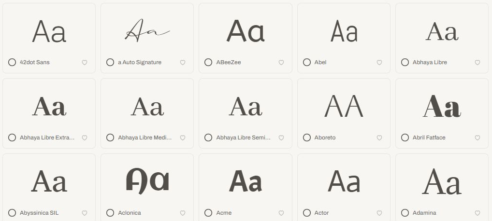

<picture>
  <source media="(prefers-color-scheme: dark)" srcset="public/logo-white.svg">
  
</picture>

# Font Time

O Font Time é um gerenciador de fontes para quem guarda muitas famílias tipográficas e usa apenas algumas em cada projeto. Adicione a pasta onde sua biblioteca já está, veja como um texto fica em cada família e ative as fontes que quiser usar em outros aplicativos. Os arquivos originais continuam na pasta que você escolheu, inclusive quando ela fica no OneDrive.

## Baixar o Font Time

| Sistema | Download da versão 0.5.0 | Como usar |
| --- | --- | --- |
| Windows 10 e 11 · 64 bits | [Instalador (.exe)](https://github.com/eugilvando/font-time/releases/download/v0.5.0/font-time_0.5.0_x64-setup.exe) | Execute para instalar ou atualizar. |
| Windows 10 e 11 · 64 bits | [Edição portátil (.zip)](https://github.com/eugilvando/font-time/releases/download/v0.5.0/font-time_0.5.0_x64-portable.zip) | Extraia o ZIP e abra `font-time.exe`. |
| macOS · Apple Silicon e Intel | [Instalador universal (.dmg)](https://github.com/eugilvando/font-time/releases/download/v0.5.0/font-time_0.5.0_macos-universal.dmg) | Abra a imagem e arraste o Font Time para Aplicativos. |
| Ubuntu 24.04 LTS · AMD64/x86-64 | [Pacote Debian (.deb)](https://github.com/eugilvando/font-time/releases/download/v0.5.0/font-time_0.5.0_ubuntu-24.04_amd64.deb) | Na pasta do download, execute `sudo apt install ./font-time_0.5.0_ubuntu-24.04_amd64.deb`. |

No Windows, o teste de atualização da 0.4.1 para a 0.5.0 confirmou a preservação da pasta monitorada, do idioma, dos favoritos e das coleções. O app instalado indexou a fonte de teste e a manteve inativa.

**macOS e Ubuntu são edições experimentais.** A instalação, a primeira abertura e a indexação de uma fonte foram testadas no macOS Intel e no Ubuntu 24.04. O pacote universal contém executáveis para Intel e Apple Silicon. O teste em hardware Apple Silicon e a notarização da Apple seguem pendentes.

Os arquivos SHA-256 para conferir os downloads e as novidades de cada versão ficam na [página de releases](https://github.com/eugilvando/font-time/releases).

## Usar uma pasta como biblioteca

1. Na barra lateral, clique em **Adicionar pasta** e selecione a pasta principal das fontes. Para usar o OneDrive, escolha a pasta sincronizada no computador e mantenha disponíveis localmente os arquivos que quiser visualizar ou ativar.
2. Expanda **Pastas** para navegar pelas subpastas encontradas. Digite uma frase no campo **Digite um texto** para ver a mesma amostra em várias famílias.
3. Clique no círculo ao lado de uma família para ativá-la. O indicador verde mostra que ela está ativa. A seção **Ativas** reúne as famílias disponíveis para uso.
4. Quando terminar o projeto, desative as fontes que já não usa. Por padrão, as fontes ativadas pelo Font Time continuam disponíveis ao fechar o aplicativo. Você pode mudar esse comportamento em **Configurações**.

## Funcionalidades

| Recurso | O que você pode fazer |
| --- | --- |
| Biblioteca e pastas monitoradas | Navegar por subpastas, acompanhar alterações e localizar fontes nos formatos TTF, OTF, TTC e OTC. |
| Busca e filtros | Pesquisar por nome e consultar todas, recentes, favoritas, ativas ou inativas. As categorias tipográficas abrangem toda a biblioteca. |
| Prévia em lista ou grade | Escolher o texto e o tamanho da amostra. A lista ajuda a avaliar uma frase inteira, e a grade facilita reconhecer o desenho das letras. |
| Amostras e comparação | Abrir uma família para explorar seus estilos e comparar até quatro famílias lado a lado. |
| Favoritas e coleções | Marcar famílias para reencontrá-las e reunir escolhas por projeto. |
| Google Fonts | Explorar o catálogo e baixar famílias pelo aplicativo. |
| Aparência e idioma | Escolher tema claro, escuro ou do sistema e usar a interface em português do Brasil, inglês ou espanhol. |

## Novidades da versão 0.5.0

- Ative ou desative um estilo na ficha da família ou na lista de estilos desagrupados. Fontes protegidas e arquivos que contêm várias faces indicam a limitação na ficha.
- Escolha a pasta principal nas configurações para receber as importações de arquivos e as famílias baixadas do Google Fonts. A pasta pode ser sua biblioteca do OneDrive. Fontes importadas ficam disponíveis para prévia e ativação manual.
- O clique direito na lista ou na grade mostra quantos itens selecionados podem ser ativados ou desativados. O menu também abre a família, as etiquetas e os grupos. Para excluir originais inativos, confira os caminhos antes de enviá-los à lixeira do sistema.
- Explore os glifos de cada estilo, pesquise por caractere, nome ou código Unicode e abra um bloco para copiar caracteres. Para glifos sem código Unicode que tenham contorno, o clique copia o desenho em SVG.
- Na barra superior, o ícone **Filtros** abre estado, categorias, etiquetas e histogramas de peso, contraste, proporção e altura-x. Você pode localizar fontes variáveis, coloridas e cópias idênticas e salvar combinações em **Filtros inteligentes**.
- As pastas conservam seus três indicadores. O círculo verde preenchido identifica todos os estilos ativos, o aro verde indica ativação parcial e o aro neutro indica que nenhum estilo está ativo.
- A ficha tem cinco abas: **Estilos**, **Licenças**, **Cascata**, **Glifos** e **Detalhes**. Trocar de aba preserva o estilo escolhido. Ajuste a escala geral entre 90% e 150% nas configurações.
- Na ficha da fonte, edite etiquetas pessoais individualmente e expanda os atributos e as etiquetas do Google Fonts quando precisar.

## Recursos da versão 0.4.1

- **Personalizar a biblioteca.** Escolha o tamanho das amostras, a velocidade de rolagem e as frases disponíveis na prévia. A primeira linha é o texto padrão. Abra uma família para atribuir um grupo e etiquetas, pesquisar por esses termos e experimentar os eixos disponíveis em uma fonte variável.
- **Transferir coleções.** Em Configurações, exporte o JSON do Font Time e importe-o em outro computador. A importação mostra as famílias ausentes antes de mesclar as coleções. Escolha ZIP para arquivar também os arquivos de fonte disponíveis das famílias selecionadas nas coleções. Observe as licenças das fontes ao compartilhar esses arquivos.
- **Sincronizar pelo OneDrive.** Selecione nas configurações a mesma pasta sincronizada nos dois computadores. Com os aplicativos abertos, o Font Time reconcilia mudanças de nome, vínculos de famílias e exclusões. As fontes ativas continuam sob controle de cada computador.
- **Escolher etiquetas.** A busca encontra as etiquetas pessoais, as classificações dos metadados e, quando habilitadas, as [etiquetas públicas do Google Fonts](https://github.com/google/fonts/tree/main/tags).
- **Ativação por documento Adobe (experimental).** Em Configurações, salve o complemento na pasta de scripts de inicialização indicada pelo Adobe Bridge. Reinicie o Bridge, habilite o script e mantenha o Bridge e o Font Time abertos. A integração lê os nomes de fontes informados pelo InDesign, Photoshop e Illustrator. O reconhecimento depende dos dados que o documento disponibiliza para cada estilo. Use **Manter ativa manualmente** na ficha de uma família para continuar a usá-la após fechar o documento. A validação nos aplicativos Adobe está pendente.

## Imagens do aplicativo

### Filtros e ficha da fonte na 0.5.0

Capturas da interface em português com uma biblioteca de demonstração.

As duas capturas a seguir mostram as vistas gerais da versão 0.3.3 no Windows.

### Biblioteca em lista

A mesma frase aparece em cada família. Use a barra lateral para filtrar fontes ativas, inativas e favoritas.

### Biblioteca em grade

A amostra curta de cada família permite observar rapidamente diferenças de peso, proporção e estilo.

## Executar o projeto no Windows

Com Node.js 22 ou superior, Rust estável, ferramentas de compilação C++ da Microsoft e WebView2 instalados, execute na pasta do projeto.

~~~sh
npm ci
npm run dev
~~~

Use `npm run build` para gerar `src-tauri/target/release/font-time.exe`. O comando `npm run instalador` gera o instalador para Windows.

Os dados do Font Time ficam em `%APPDATA%\com.eugilvando.fonttime`. O instalador Windows da versão 0.4.1 incorpora a chave pública do projeto para conferir a assinatura das próximas atualizações. Quem usa a versão 0.3.3 atualiza manualmente uma vez.

## Origem e licença

Font Time deriva do [Tuna Fonts de AtunFrito](https://github.com/atunfrito/tuna-fonts). O código de origem mantém os créditos e a [licença MIT](LICENSE). As licenças das fontes e dos demais componentes estão em [avisos de terceiros](THIRD-PARTY-NOTICES.md).
